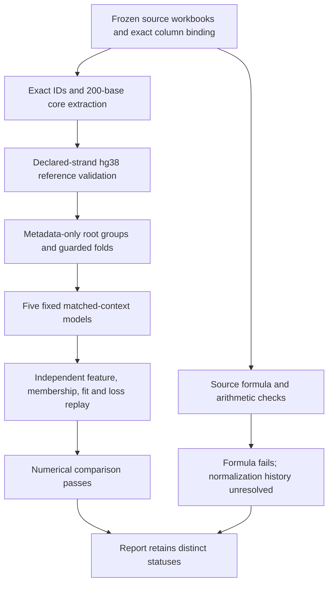
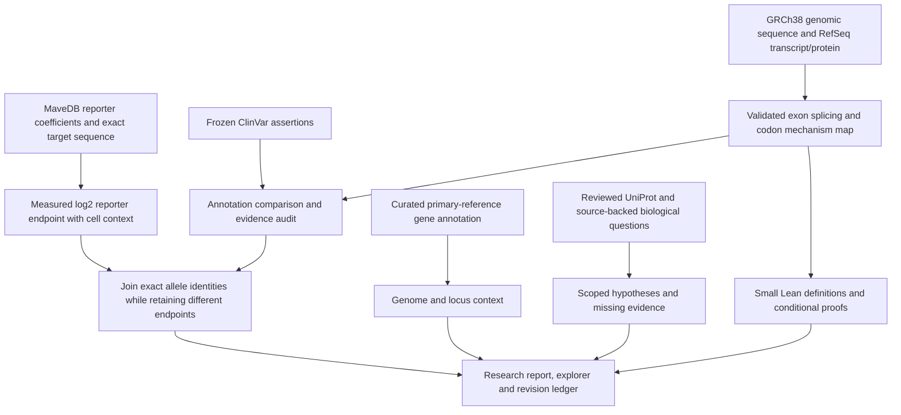
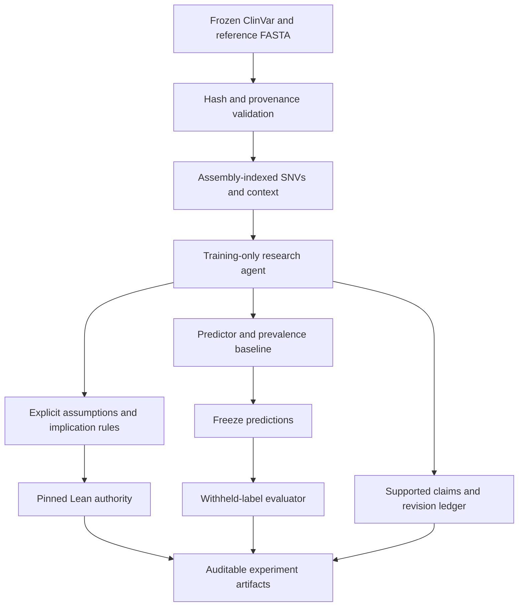

# Architecture and trust boundaries

The **17-crate workspace** keeps numerical reproduction and scientific endpoint
validation as separate gates. The current matched-context benchmark has
13.434% lower held-out MSE on its fixed published columns and passes all 243
independent numerical comparison categories. Its source columns fail the
published ESS formula, so scientific source-formula validation remains
unresolved and the complete check exits 2. No target projection repairs that
status.

The next scientific goal is authoritative normalization/raw-activity provenance
or independently compatible measurements. A weighted rank-two source relation
narrows compatible arithmetic descriptions; it does not identify the producer's
history. See the [study](../research/context-specificity-study.md) and
[source-semantic review](../research/context-specificity-semantic-review.md).

The HBB workflow combines the original clinical demonstration with a reference
mechanism engine, a curated atlas and separately produced reporter evidence:

Reporter records use a separate quantitative type with units, source accession,
cell line and assay context. They are not converted into clinical labels or used
to promote predicted clinical claims. The assay's target-reference orientation
and the gene's transcription orientation are verified separately.

The research audit checks artifact commitments, ordered revisions, report-to-ledger
bindings, duplicate JSON payloads and the scoped proof. It does not authenticate
source identity or establish biological truth. The hypothesis IDs are fixed by
the finite analysis protocol; alternate files must retain its defined ID set.

The original demo path below remains available and its proof format is preserved.

## Claims and evidence

A proposition identifies a local variant key, biological context and clinical
assertion. A matching curated assertion can support a claim, not establish direct
measurement. Predicted evidence cannot support its own prediction.

Replication promotion requires measured evidence from at least two distinct
nonempty study identities. This checks a data contract; review must still
establish independence and measurement quality. The demo claims no replication.

The evidence registry is content-addressed. Every ledger revision commits to its
payload, event kind, sequence and previous hash. The report commits to inputs,
model counts, predictions and proof.

## Formal boundary

`genome-logic` derives only conclusions reachable from supplied premises through
finite unary implications. It generates propositional symbols internally, so
untrusted atom text cannot inject Lean syntax. Rules carry human-readable
scientific assumptions in the report.

`genome-proof` emits a theorem with premises and rules as hypotheses, plus concrete
natural-number probability bounds. It requires Lean 4.19.0, rejects failed checks,
and terminates proof execution after 30 seconds. The artifact names its authority
and exact source commitment.

Saved proofs are checked against the same finite export grammar before audit
invokes Lean. Imports, evaluation commands, extra axioms and admitted proofs are
rejected rather than treated as user-supplied programs.

The theorem does not establish atom meaning, ClinVar truth, exchangeability,
appropriate decision costs, or relationships in nature. A future LLM can propose
typed statements and rules, not arbitrary Lean programs.

## Evaluation and reproducibility

Fitting accepts training examples. Prediction accepts label-free features.
Evaluation requires exactly one prediction per held-out label. Both models'
predictions enter the ledger before evaluation.

Outputs are deterministic for the same inputs, code revision and authority.
JSON floating-point round trips preserve numeric commitments. The artifact
manifest is written last; incomplete output cannot pass audit.

Hashes are not authentication. Manifests and source URLs need review. A malicious
replacement of all commitments creates another internally consistent experiment.
The process is trusted to follow API boundaries; shell-capable agents require
separate capabilities and an inaccessible holdout store.

## Current boundaries

The `helix context-study` path uses `genome-context-model` for a small generic
matched-context ridge model. The crate enforces engineering contracts; the
frozen scientific protocol separately binds source, endpoint, core, grouping,
guard, features, penalty and interpretation. The CLI verifies the protocol and
input commitments and retains all model fits, predictions, source-feature
dumps, losses and resampling artifacts. The model does not choose a biological
endpoint or establish one from a label's name.

Independent Python reparses the raw workbooks, extracts source230[15:215]
cores, validates every declared hg38 interval/strand, rebuilds group/guard
membership and computes the features without importing Rust. All 55,276
integer-count vectors and 1,824,108 feature fractions match exactly; 829,140
model predictions and every required numerical comparison pass within frozen
tolerances. Independent implementations remain computation checks rather than
independent experimental measurements.

Source ESS semantics have a separate failed/unresolved flag. The observed
columns do not obey the cited zero-sum formula; fitting a weighted plane does
not validate an undocumented normalization. Published values remain unchanged.
The full-library source transformation also prevents a prospective,
training-only target-preprocessing claim. Model training uses only its training
features/labels, but cannot undo the source's panel-level processing.

The complete `scripts/check_context_study.sh` replay produces numerical and
source diagnostics before returning 2 for unresolved scientific validation.
Direct model execution or an integrity audit must not be interpreted as passing
that separate gate. The [context snapshot](../research/results/context-specificity-v2/README.md)
retains the failed source interpretation alongside reproduced computation.

The separate `helix study` path uses `genome-regulatory-data` to validate a
metadata-selected, source-frozen cohort and `genome-regulatory` to execute the
fixed six-model protocol. Model inputs retain sequence and mutation identity;
quality/source fields do not enter the predictor. Training-only scaling,
guarded HBB folds and held-out promoter folds have explicit memberships.
The schema3 artifact includes complete compressed predictions/fits, controls,
context comparisons, input commitments and a revision ledger. Its audit verifies
internal bindings and the scoped method proof; it does not refit every model.

An independent NumPy/SciPy implementation rebuilds features and fits from raw
sources. Continuous predictions, primary losses and controls reproduce, while
26 secondary exact-rank comparisons remain failed. The separately specified
post-hoc finite-grid study is retained alongside that failure. This distinction
is visible in machine-readable flags and the workflow's exit status. Read the
[complete regulatory study](../research/regulatory-study.md) for the scientific
result and limits. The proof covers guard arithmetic, same-input prediction uniqueness
and finite-control resolution, not model coefficients or biological validity.

Mechanism calculations remain limited to the named HBB GRCh38 transcript and
biallelic SNVs. The atlas supplies source-specific genome-wide annotation context;
it does not compute genome-wide variant effects. No full VRS normalization,
indel/liftover engine, validated causal model, general-purpose proof kernel, live
model API, physical experiments or clinical decision workflow is implemented.
