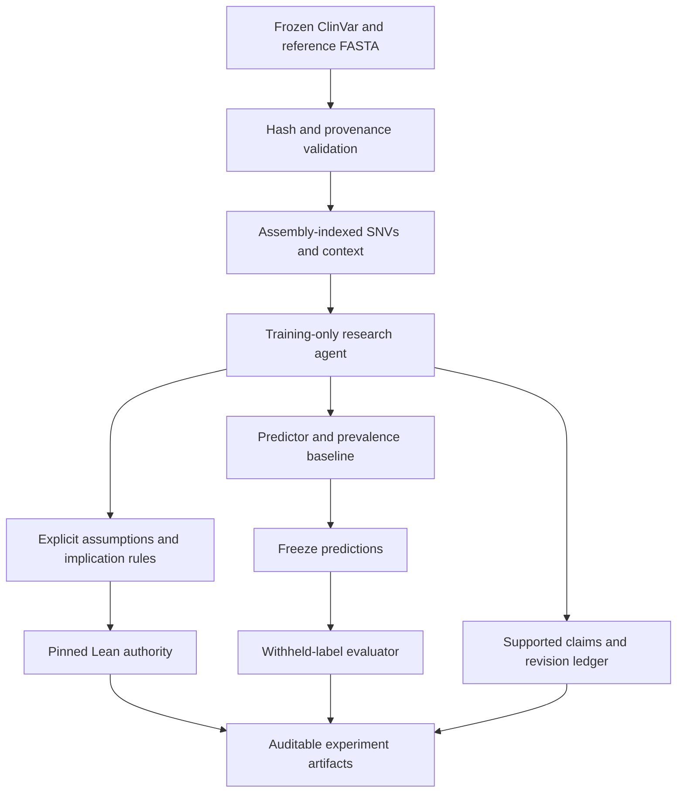

# Architecture and trust boundaries

## Claims and evidence

A proposition identifies a local variant key, biological context and clinical
assertion. A matching curated assertion can support a claim, not establish direct
measurement. Predicted evidence cannot support its own prediction.

Replication promotion requires measured evidence from at least two distinct
nonempty study identities. This checks a data contract; review must still
establish independence and measurement quality. The demo claims no replication.

The evidence registry is content-addressed. Every ledger revision commits to its
payload, event kind, sequence and previous hash. The report commits to inputs,
model counts, predictions and proof.

## Formal boundary

`genome-logic` derives only conclusions reachable from supplied premises through
finite unary implications. It generates propositional symbols internally, so
untrusted atom text cannot inject Lean syntax. Rules carry human-readable
scientific assumptions in the report.

`genome-proof` emits a theorem with premises and rules as hypotheses, plus concrete
natural-number probability bounds. It requires Lean 4.19.0, rejects failed checks,
and terminates proof execution after 30 seconds. The artifact names its authority
and exact source commitment.

Saved proofs are checked against the same finite export grammar before audit
invokes Lean. Imports, evaluation commands, extra axioms and admitted proofs are
rejected rather than treated as user-supplied programs.

The theorem does not establish atom meaning, ClinVar truth, exchangeability,
appropriate decision costs, or relationships in nature. A future LLM can propose
typed statements and rules, not arbitrary Lean programs.

## Evaluation and reproducibility

Fitting accepts training examples. Prediction accepts label-free features.
Evaluation requires exactly one prediction per held-out label. Both models'
predictions enter the ledger before evaluation.

Outputs are deterministic for the same inputs, code revision and authority.
JSON floating-point round trips preserve numeric commitments. The artifact
manifest is written last; incomplete output cannot pass audit.

Hashes are not authentication. Manifests and source URLs need review. A malicious
replacement of all commitments creates another internally consistent experiment.
The process is trusted to follow API boundaries; shell-capable agents require
separate capabilities and an inaccessible holdout store.

## Current boundaries

HBB GRCh38 biallelic SNVs only. No full VRS normalization, indels, liftover, causal
effects, invented confidence intervals, general-purpose proof kernel, live model
API, physical experiments or clinical decision workflow.
