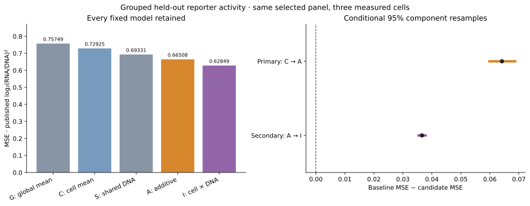
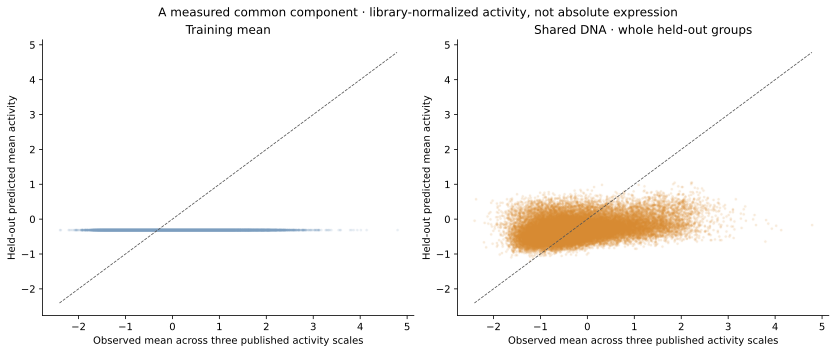
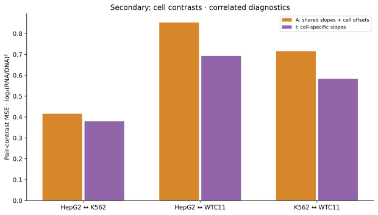

# Predicting activity on a source-validated regulatory panel

## Result and scope

The fixed DNA model lowers held-out MSE by **8.7996%** beyond cell-specific
training means on the **published library-normalized activity columns**.
Context-mean prediction has MSE **0.729254313**; additive DNA/context prediction
has MSE **0.665082737**. The primary improvement is **0.064171577**, with a
conditional 95% component-resampling range **[0.059844002, 0.068716904]**.

Independent Rust/Python reproduction passes **258/258 comparison categories**,
including all **829,140 model predictions**, maximum absolute difference
**6.375e-12**, exact source observations and all **1,824,108 feature fractions**.
No prediction/metric tolerance was widened and no outcome transformation,
hyperparameter tuning or favorable subset selection was added.

This is a bounded predictive result for **55,276 source-selected elements,
2,761 sequence/locus groups and three measured cell contexts**. It concerns the
mean of three published library-normalized activity scales, not absolute
expression, universal shared TF strength, an unseen cell or independent
biological replication. Source specificity alone does not uniquely identify
that mean; the mean may nevertheless share predictive information with
specificity, especially under unequal upstream cell gains.

The source's upstream activity-to-ESS construction remains unresolved.
Recovering activity and predicting these literal columns does not validate
the old simple ESS formula or retrospectively pass the blocked raw-activity v1.
The [endpoint-recovery report](context-endpoint-recovery.md) retains the
successful downstream source relation and all 36 failed upstream candidates.

## Frozen question, source and exposure

The authority is [context-activity-v3](../experiments/context-activity-v3.json),
SHA-256 `64e14037fb1f42ddc1ecaca1d23bb8096fabac1f1e892d105eaa20f525fbbb20`,
frozen at `2026-10-27T18:42:05.586647+00:00`. It was fixed **after archive
download had begun, but before new workbook headers or activity values were
inspected**. Prior specificity scores/results, public methods, code-derived
schema expectations and the source-selected panel were already known.
This is a separately versioned endpoint study, not an outcome-naive source
selection or an untouched research history.

The source is Agarwal et al., *Massively parallel characterization of
transcriptional regulatory elements*, Nature (2025), DOI
[10.1038/s41586-024-08430-9](https://doi.org/10.1038/s41586-024-08430-9),
PMID 39814889. The official supplementary archive's S11 `jointdata.xlsx`
is **53,557,805 bytes**, SHA-256
`9c95ca2b8df0ff3edc7dda4fdcf337f33e652b96a0833a70e786bbcdc2b76b4e`.

The worksheet `all_cell_types_summary` supplies exact `name` IDs and the
three literal aggregate columns:

- `HepG2 [log2(rna/dna)]`
- `K562 [log2(rna/dna)]`
- `WTC11 [log2(rna/dna)]`

These observed aggregates are used unchanged. They are neither ESS inversions
nor source model predictions. The [dataset manifest](../datasets/context-activity/manifest.json)
binds official archive/member integrity, schema, exact ID coverage, design
identity and recorded aggregation uncertainty. All 55,276 pre-existing admitted
IDs have ordinary finite numeric values in all three columns. Missingness
outside that fixed panel is retained; it does not choose a new favorable subset.

Final-archive design and fold/score workbooks are byte-identical to old S7/S9.
Thus the 200-base cores and previously verified coordinates, groups and guards
are reused without changing their memberships by activity. Old ESS values,
scalers, fits and predictions are not reused as v3 outcomes or fitted quantities.

Published processing already includes library-level normalization and QC before
our grouped split. No prospective, training-only target-preprocessing claim is
made. “Raw activity” here must not be confused with untouched barcode counts
or absolute transcripts per cell. The literal aggregate differs from the mean
of three published unrounded replicates at a magnitude compatible with rounding
(maximum approximately 0.0005); its exact historical aggregation/normalization
is not reconstructed. That uncertainty was recorded before fitting.

## Evaluation and fixed models

Each 230-base deposited design contains 15-base adaptor, 200-base core and
15-base adaptor. Features use only the core: **32 reverse-complement-canonical
overlapping trinucleotide frequencies and GC fraction**. No activity, source
prediction, support count, source category, activity bin or test-derived
statistic enters the feature vector.

All contexts of an element share one test fold. The frozen 2,761 root groups
combine exact/reverse-complement identity, documented parents, genomic overlap,
one-megabase bins and the declared 90% global ungapped similarity rule, including
transitive links. Whole training components within the inclusive 10,000-base
test guard are removed. These groups were independently reproduced in v2 and
are byte-bound unchanged for v3.

Ridge uses fixed alpha ten under summed squared error, an unpenalized training
intercept and training-only population feature means/SDs. Shared slopes fit one
three-cell mean target per training element; independent fits use the same
feature design and penalty per context. This preserves aligned regularization
rather than silently fitting pooled shared rows with a different effective
penalty.

| Model | Held-out prediction |
| --- | --- |
| G: global mean | One training observation mean |
| C: context means | One training mean for each measured cell |
| S: shared DNA | Shared sequence slopes plus global training mean |
| A: additive DNA/context | The exact S slopes plus training context intercepts |
| I: independent-context DNA | Separate sequence slopes and intercept per measured cell |

The **single primary comparison is C minus A**, index one in the retained
three-comparison array. Loss first averages cells within element, then elements
equally. Equal-component loss is a fixed sensitivity, not the primary estimand.

An inherited generic-core interpretation note calls group weighting “primary.”
That sentence is inapplicable metadata for v3: the immutable caller protocol,
reported primary numbers and resampling use **equal-element weighting**.
Both weighting schemes remain in the artifacts; the source snapshot is not
silently edited while fitting.

## All model results

MSE units are squared published log2 RNA/DNA activity units; MAE uses the same
published log2 units.

| Model | Equal-element MSE | Equal-element MAE |
| --- | ---: | ---: |
| G: global mean | 0.757485893 | 0.665172680 |
| C: context means | 0.729254313 | 0.646366733 |
| S: shared DNA | 0.693314317 | 0.634163336 |
| A: additive DNA/context | 0.665082737 | 0.612929276 |
| I: independent-context DNA | 0.628493627 | 0.593678740 |



All three prespecified comparisons are retained; no comparison was selected
after inspecting the results.

| Role and contrast | MSE improvement | Conditional 95% range |
| --- | ---: | --- |
| Primary: C minus A | **0.064171577** | **[0.059844002, 0.068716904]** |
| Diagnostic: S minus A | 0.028231580 | [0.026837926, 0.029653566] |
| Secondary: A minus I | 0.036589109 | [0.035401682, 0.037836167] |

Primary MAE improves by **0.033437457**, with conditional range
**[0.031493738, 0.035447549]**. Full per-cell, per-fold, per-element, per-group
and pair-contrast losses, equal-component sensitivity and every resampling
statistic remain in the snapshot.

The 2,000 common paired component draws preserve all element/context members.
Each draw pools loss sums and element counts with component multiplicity.
These are conditional fixed-out-of-fold-loss percentile ranges: they omit
refitting, source-normalization uncertainty, residual inter-group dependence
and study-to-study variation. They are not calibrated p-values, genome-wide
prevalence estimates or population confidence guarantees.

## What the mean-activity diagnostic establishes

For a held-out element, let `a_bar` be the mean of its three observed published
activity values, `m` the training grand mean and `f` the shared sequence
prediction change. The shared model predicts `m+f`; the additive model
predicts `m_c+f`. Balanced cells imply:

```text
MSE_cells(C) - MSE_cells(A)
    = (a_bar-m)^2 - (a_bar-m-f)^2
```

The same primary gain can therefore be read as improved prediction of the
mean of these published cell scales. Global-mean prediction of that mean has
MSE **0.508755046**; shared DNA has MSE **0.444583470**. The mean-activity gain
is **0.064171577**, matching primary C-minus-A. The maximum per-element identity
residual is **1.066e-14**.



This is a correlated algebraic diagnostic, not independent biological
corroboration. The mean is a statistical target, not a recovered physical
quantity or a universal regulatory factor. The formal
[identifiability note](context-identifiability.md) establishes nonunique
inversion for ideal centering; it does not say all raw-mean signal is absent
from every specificity representation.

The retained cell-pair comparisons likewise share the same observations and
predictions. Balanced-model contrast identities are implementation checks,
not additional independent experiments.



## Independent replay and retained attempts

The Python adapter independently reads the original XLSX with pinned openpyxl,
binds exact headers/IDs, rejects formulas/errors/booleans/nonfinite required
values and preserves the source floats. It does not use the normalized export
as its target source. It re-extracts every DNA feature and refits every outcome
model using previously inspected independent NumPy fitting/bootstrap functions,
rather than importing Rust calculations.

Seventeen new synthetic controls cover strict binding/gates, missingness and
numeric types, a hand-computed shared ridge result, preservation of nonzero
activity means, and the primary mean-activity identity. The complete comparator
checks all source observations, memberships, counts/fractions, fitted scalers,
coefficients, predictions, losses, shared draw tables, intervals and diagnostic
records at frozen absolute tolerances 1e-7 for predictions/fits and 1e-8 for
losses/statistics. Observed values and feature fractions match exactly.

The first Python attempt stopped before parsing activity or fitting because its
gate checker incorrectly required exactly seven manifest files rather than
allowing extra committed provenance receipts. The verifier was corrected to
require essential receipts and hash every listed file. That failed attempt,
the corrected code and the successful replay are all retained. Endpoints,
models, targets, penalties, folds and tolerances were unchanged.

## Reproduction, limits and next goal

The [published snapshot](results/context-activity-v3/README.md) contains source
bindings, complete fits/predictions, all diagnostics, code snapshots and the
independent comparison. After pinned setup, use a new prefix:

```bash
bash scripts/check_context_activity.sh runs/activity-review
```

The complete workflow passed from clean source commit
`035ca5731fe594622cd2c3c27cd3bb51ec65c924`, including source gates, Rust
fit and audit, independent Python fit, all 258 comparisons and three figures.
The publication records `working_tree_dirty: false` and retains the earlier
attempts separately. Source/reference commitments must remain intact. Numerical reproduction, source binding and the unresolved
upstream ESS history have separate flags. A complete numerical pass does not
turn the old v2 formula failure into a success.

The study paper already models activity/specificity from sequence. This
experiment supplies a new-to-analysis bounded benchmark under fixed small
features and strict grouping, not a globally new method or biological mechanism.
Source cohort selection, measured-cell assay/delivery differences and unavailable
raw-count uncertainty remain. Native regulatory causality, endogenous target
genes, clinical consequences and unseen-cell/source transfer require additional
discriminating observations.

The next scientific work is to resolve upstream normalization where authoritative
evidence permits it, and evaluate compatible measurements in an independent
setting. Preserve the failed 36 reconstruction routes, blocked v1, older negative
promoter study and failed raw exact-rank endpoint; new positive activity
prediction does not supersede those different questions.
