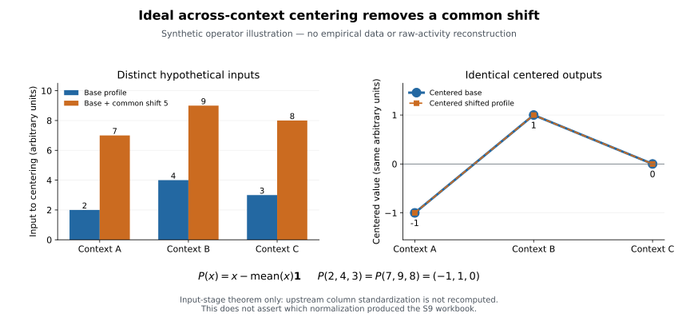
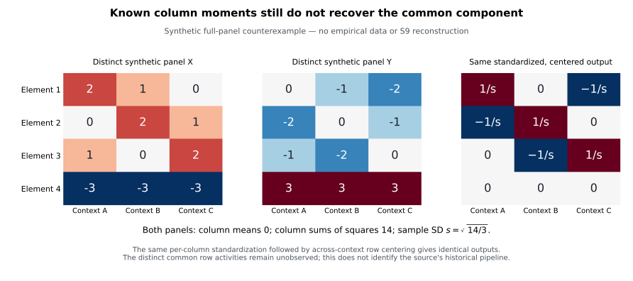

# Endpoint recovery, relative activity and identifiability

## Scope and current boundary

This review asks two different questions: **which documented processing produced
the frozen published columns, and which quantities could that processing retain?**
Recovering the producer's history would resolve an important source question.
It would not, by itself, invert a many-to-one operation or recover absolute
transcripts per cell.

Round 3 began with public literature/code metadata; the recovery and activity
contracts were frozen before new workbook headers/values were inspected.
Authorized acquisition and recovery arithmetic followed; independent activity
fitting and all 258 numerical comparison categories now pass. Earlier v2
scores, formula failure and benchmark are exposed evidence, not a new holdout.
The mathematical examples here are synthetic. Current empirical status is in
the [round 3 report](context-endpoint-recovery.md).

The existing [source-semantic review](context-specificity-semantic-review.md)
establishes that the old S9 columns violate the paper's unweighted ESS formula
but satisfy a fitted unequal-weight plane. Neither that fit nor this review
identifies historical preprocessing. The v2 targets/results remain unchanged.

## Three measurement levels

| Level | Observation | What is still needed |
| --- | --- | --- |
| Barcode RNA and DNA counts | Sequenced counts per barcode/sample, with assay design and library representation | Replicate identities, sampling depths, count/QC rules, barcode associations and calibration assumptions |
| Uncentered normalized reporter activity | For example, a source aggregate of library-normalized log2 RNA/DNA, before across-cell specificity centering | Exact normalization/aggregation and version lineage; count-level uncertainty is not recovered from an aggregate |
| Centered/scaled specificity columns | Relative patterns after the specified transformations | Source operation order/scales; the removed common component is generally not recoverable from these values alone |

The earlier v1 phrase “raw activity” meant the second level, not untouched reads
or absolute molecules per cell. Recovering that endpoint would be useful even
though it remains library-normalized reporter activity. A reporter's RNA/DNA
ratio also differs from endogenous gene expression, protein output or physiology.

MPRAnalyze explicitly models DNA construct representation and RNA counts,
including library/covariate correction factors and uncertainty in both libraries.
Its transcription parameter is conditional on that model and normalization,
rather than an automatic absolute per-cell molecule count. mpralm analyzes
log-ratio activity with precision weights related to DNA abundance and
experimental-design terms. Both are established reasons to retain barcode,
replicate and processing provenance when an aggregate table is recovered.
Neither method can reconstruct information already discarded by an undocumented
centering operation. [R03, R04]

## What the final article and preprint actually say

The final paper's Methods “Calculation of element specificity scores” defines
per-cell z-score transformation followed by subtraction of each element's mean
across all three cells. The preprint gives the same operation under
“Calculation of element specificity scores (ESSs).” Both descriptions imply an
unweighted zero row sum. The SD convention before row centering cannot explain
the observed old-S9 nonzero row sums. [R01, R02]

The final article identifies its full ESS table as Supplementary Table 10.
The preprint identifies its corresponding table as Supplementary Table 7 and
describes activity/replicate summaries as well. The frozen Zenodo file named
“Table S7 - joint lib design.xlsx” is design-only, while its S9 contains the
three specificity columns. This is a documented version/table mapping problem;
numbers or filenames alone do not prove that those assets are the same release
or carry the same endpoint.

A useful evidence chain must connect **publication version → deposited asset
bytes → worksheet/columns → exact element IDs → processing code/version →
measured or transformed endpoint**. Code that merely loads `mean_value`,
splits folds or predicts activity does not establish how that value was
created. Earlier code-only inspections of the pinned `human_legnet` and
`sequence_cnn_models` loaders found no ESS creation history; those limited
negative checks do not rule out upstream or external code.

The subsequently verified official archive supplies a joint-data workbook with
activity and ESS fields, plus design/fold workbooks byte-identical to old S7/S9.
The [round 3 report](context-endpoint-recovery.md) records that exact lineage and
a fixed downstream numerical map: standardizing S11 ESS over the exact 55,338
S12 IDs with sample SD reproduces all 166,014 old model-score cells, maximum
error 5.152e-14. All 36 frozen activity-to-ESS routes still fail. This narrows
the representation relationship without establishing upstream historical
normalization. The separately frozen v3
[activity study](context-activity-study.md) improves held-out prediction of the
mean of published library-normalized cell scales and independently reproduces
all required numerical checks.

The downstream public repository
[TaykhoomDalal/LentiMPRA-Enhancer-Processing](https://github.com/TaykhoomDalal/LentiMPRA-Enhancer-Processing)
already specifies this ESS subset/sample-z-score check in `validate_joint_ess`.
The pinned [code](https://github.com/TaykhoomDalal/LentiMPRA-Enhancer-Processing/blob/d2751a6ddff67ce4406288e9f6c3d932b0c12cdd/LentiMPRA/process.py#L633-L661)
has the same function AST in the reported initial 2026-08-21 commit. This
predates our investigation according to public GitHub metadata; unsigned
commit dates are not authenticated producer history. The
[code trace](context-normalization-trace/README.md) retains those snapshots and
limits. The candidate operation is prior work, not a globally new hypothesis;
the bounded official-byte comparison is this analysis's specific result.

Outstanding fields must come from frozen-round receipts rather than
predictability or a favorable fitted transform. The separate activity-v3
protocol was frozen before these new headers or activity values were inspected.

## Established linear algebra: what centering removes

For a three-context input `x`, let `1=(1,1,1)` and
`P=I-11'/3`. Across-context centering is `e=Px`. Then:

```text
P(x + h*1) = Px
kernel(P) = span(1)
rank(P) = 2
```

Thus equal centered values identify an equivalence class of input profiles
differing by a common shift, rather than one input. For a panel, the shift may
differ by element: an entire vector of element-specific common components can
be hidden. Zero centered output does not imply a zero input.

Any fixed downstream operation `f` still satisfies
`f(P(x+h*1))=f(Px)`. Extra column scaling can hide the simple zero-sum
appearance, but cannot restore the already removed component. An exact
decoder for every unrestricted input cannot exist: it would have to decode the
same centered vector as two different inputs.

A learned model or prior can choose one representative of that equivalence
class, but this is assumption-based prediction using additional information,
not inversion of the observed specificity. Validate any such prediction against
independent uncentered measurements. More precise observations through the
same noninjective operator do not, by themselves, identify its missing component.

These are established projection/nonidentifiability facts. The
[Lean development](../proofs/ContextIdentifiability.lean) encodes the ideal
map as `center3(x)=3*x-sum(x)*1`, avoiding truncated integer division.
Its formal statements concern that map and explicitly stated extensions, not
the biological truth of a source formula. Rational examples admit a common
integer denominator; real-valued linear-algebra interpretation remains separate
from claiming a formal theorem about a historical experimental pipeline.



The hand-chosen profiles `(2,4,3)` and `(7,9,8)` both center to
`(-1,1,0)`. This is an input-stage example, not empirical raw-activity recovery.
It does not recompute upstream per-column z-scores and makes no S9 claim.

### Fixed upstream normalization changes the hidden direction

If upstream normalization is fixed as
`z[c]=(r[c]-mu[c])/sigma[c]`, a shift `r[c] += h*sigma[c]` produces a
common shift in z and is removed by P. A literal equal raw shift is removed
only under appropriate equal-gain conditions. If normalization is recomputed
from a changed panel, arbitrary shifts may alter its column variances.
An input-stage invariance theorem alone must not silently assume otherwise.

The mean of raw or published activity scales can mix retained contrasts under
unequal cell gains. Nonunique identification does not imply independence or
absence of all predictive information. V3 tests prediction of that mean using
newly recovered observations; it does not infer the mean by inverting ESS or
identify a universal TF-strength component.

### Knowing column moments still need not identify the input

A stronger counterexample respects the full-panel moment constraints. Let the
four rows of two synthetic panels be:

```text
X = ( 2, 1, 0)       Y = ( 0,-1,-2)
    ( 0, 2, 1)           (-2, 0,-1)
    ( 1, 0, 2)           (-1,-2, 0)
    (-3,-3,-3)           ( 3, 3, 3)
```

Every column in both panels has mean zero and sum of squares 14. Both therefore
share the same population SD `sqrt(14/4)` or sample SD `sqrt(14/3)`.
Their row means are `(1,1,1,-3)` versus `(-1,-1,-1,3)`, yet corresponding
centered rows agree. The same column standardization followed by row centering
still gives identical outputs. Known global first/second moments do not
generally identify the missing element-wise common component.



This is an exact counterexample for an ideal construction, not a demonstration
that either panel generated the published source. Formalization and synthetic
visualization provide inspectable statements, not a claim of globally new
mathematics. Exact CSVs, frozen inputs and provenance accompany both
[figures](context-identifiability-figures/README.md).

## Weighted planes, scale and misleading biological interpretations

If a centered matrix E is subsequently column-scaled as
`Y=E*diag(1/s)`, then `Y*s=0`. A rank-two Y may determine relative null
weights up to overall scale. This identifies an algebraic representation under
the assumed class, not the historical operator, absolute scale, original
activity means or each element's discarded common component. Many distinct
upstream histories can share the same Y.

Centering also induces dependence. If three uncentered input coordinates are
independent with equal variance `v`, then `Cov(Px)=v*P`: each variance is
`2v/3`, each off-diagonal covariance `-v/3`, and each pair correlation
`-1/2`. Negative association can therefore arise without biological antagonism.

More generally, if three unit-variance columns obey
`w1*Y1+w2*Y2+w3*Y3=0`, their correlations are constrained; for example:

```text
rho(Y1,Y2) = (w3^2 - w1^2 - w2^2) / (2*w1*w2)
```

This is conditional algebra, not a new empirical round 3 measurement.
A fitted plane and pairwise correlations derived from that plane are not
independent biological confirmations. Predictive performance on supplied
columns can remain a valid bounded numerical result while direct mechanistic
interpretations of their correlations remain unsupported.

## Relative-data literature: useful analogy, explicit limits

Lovell et al. explain the many-to-one mapping from absolute to relative
abundances and demonstrate that relative correlations need not identify
absolute relationships. Gloor et al. review the lost-scale consequences of
sequencing compositions. Lovén et al. show why cell-number-linked calibration
can change interpretation of global RNA-expression shifts. These are extensive
prior art for the general warning that relative measurements need external
information or assumptions to support absolute claims. [R05–R07]

**ESS is signed centered data, not automatically a positive composition.**
It need not be a vector of proportions summing to one. The centered log-ratio
transform in compositional analysis is `log(x/geometric_mean(x))` for positive
parts; that is not the stated ESS map “column z-score then row mean.”
Applying logs/CLR to negative ESS values, adding arbitrary pseudocounts, or
importing compositional tests without their assumptions is unjustified.

The analogy concerns information loss and induced dependence. It does not
prove a specific source was processed compositionally, invalidate every
descriptive correlation, or authorize changing the frozen endpoint. A claim
about absolute regulation requires the appropriate observation/calibration
contract, not merely a different statistical transformation.

## Questions that the frozen recovery round can discriminate

| Question | Evidence that would resolve it | What would remain unresolved |
| --- | --- | --- |
| Does an authorized version-linked asset contain uncentered measured activity? | Explicit worksheet/column definition, exact IDs and source provenance, with acquisition bounded by the frozen contract | Aggregate uncertainty and absolute per-cell calibration may still be absent |
| Can documented code reproduce old S9 from the corresponding source activity? | Pinned authoritative operation order and independently reproduced exact-ID comparison, retaining all mismatches | A numerically compatible candidate alone is not historical evidence |
| Is additional column scaling explicitly part of that source version? | Version-linked code/metadata plus matching intermediate/output bytes | Raw common activity is not recovered from a centered output solely by undoing scaling |
| Can the discarded common component be reconstructed from specificity alone? | In general, no: the ideal map has a nontrivial kernel, even with the demonstrated moment constraints | Particular recovery would require genuinely additional measurements/assumptions |
| Does recovered normalized activity establish absolute transcription per cell? | Only with an appropriate calibration/assay contract, not its label or a finite read total | Native target regulation, protein/physiology and causal TF identity need independent evidence |

Source licensing/access failure is an acquisition outcome, not biological
evidence. A semantic mismatch is not a negative model result. An exact algebraic
counterexample is not an empirical source reconstruction. Keep all three
statuses visible.

## Novelty boundary before round 3 findings

| Claim | Defensible status |
| --- | --- |
| Centering loses a common component; relative quantities do not identify all absolute quantities | Established mathematics and measurement prior art |
| Known column moments do not generally restore injectivity | An explicit counterexample/formalization here; no global novelty claim |
| Barcode/count uncertainty and normalization matter for MPRA comparison | Established methodology, including MPRAnalyze and mpralm |
| Old S9's exact formula mismatch, null weights and version/table mapping | Analysis-specific source observations documented in v2; global novelty unestablished |
| Official archive design/fold byte identity; S11 ESS subset-standardization reproduces old model labels | Analysis-specific numerical source bridge, fixed before new values; upstream activity-to-ESS routes still fail, and global novelty is unestablished |
| A new biological mechanism or full reconstruction of human genome regulation | Unsupported by this literature review or synthetic examples |

## References

- **[R01]** Agarwal V et al. *Massively parallel characterization of transcriptional
  regulatory elements.* Nature (2025).
  DOI [10.1038/s41586-024-08430-9](https://doi.org/10.1038/s41586-024-08430-9);
  PMID [39814889](https://pubmed.ncbi.nlm.nih.gov/39814889/);
  [open article](https://pmc.ncbi.nlm.nih.gov/articles/PMC11903340/).
- **[R02]** Agarwal V et al. *Massively parallel characterization of transcriptional
  regulatory elements in three diverse human cell types.* Preprint (2023).
  DOI [10.1101/2023.03.05.531189](https://doi.org/10.1101/2023.03.05.531189);
  PMID [36945371](https://pubmed.ncbi.nlm.nih.gov/36945371/);
  [article record](https://pmc.ncbi.nlm.nih.gov/articles/PMC10028905/).
- **[R03]** Ashuach T et al. *MPRAnalyze: statistical framework for massively
  parallel reporter assays.* Genome Biology 20, 183 (2019).
  DOI [10.1186/s13059-019-1787-z](https://doi.org/10.1186/s13059-019-1787-z);
  PMID [31477158](https://pubmed.ncbi.nlm.nih.gov/31477158/);
  [open article](https://pmc.ncbi.nlm.nih.gov/articles/PMC6717970/).
- **[R04]** Myint L et al. *Linear models enable powerful differential activity
  analysis in massively parallel reporter assays.* BMC Genomics 20, 209 (2019).
  DOI [10.1186/s12864-019-5556-x](https://doi.org/10.1186/s12864-019-5556-x);
  PMID [30866806](https://pubmed.ncbi.nlm.nih.gov/30866806/);
  [open article](https://pmc.ncbi.nlm.nih.gov/articles/PMC6417258/).
- **[R05]** Lovell D et al. *Proportionality: A Valid Alternative to Correlation
  for Relative Data.* PLoS Computational Biology 11, e1004075 (2015).
  DOI [10.1371/journal.pcbi.1004075](https://doi.org/10.1371/journal.pcbi.1004075);
  PMID [25775355](https://pubmed.ncbi.nlm.nih.gov/25775355/);
  [open article](https://pmc.ncbi.nlm.nih.gov/articles/PMC4361748/).
- **[R06]** Gloor GB et al. *Microbiome Datasets Are Compositional: And This Is
  Not Optional.* Frontiers in Microbiology 8, 2224 (2017).
  DOI [10.3389/fmicb.2017.02224](https://doi.org/10.3389/fmicb.2017.02224);
  PMID [29187837](https://pubmed.ncbi.nlm.nih.gov/29187837/);
  [open article](https://pmc.ncbi.nlm.nih.gov/articles/PMC5695134/).
- **[R07]** Lovén J et al. *Revisiting global gene expression analysis.*
  Cell 151, 476–482 (2012).
  DOI [10.1016/j.cell.2012.10.012](https://doi.org/10.1016/j.cell.2012.10.012);
  PMID [23101621](https://pubmed.ncbi.nlm.nih.gov/23101621/);
  [article record](https://pmc.ncbi.nlm.nih.gov/articles/PMC3505597/).
