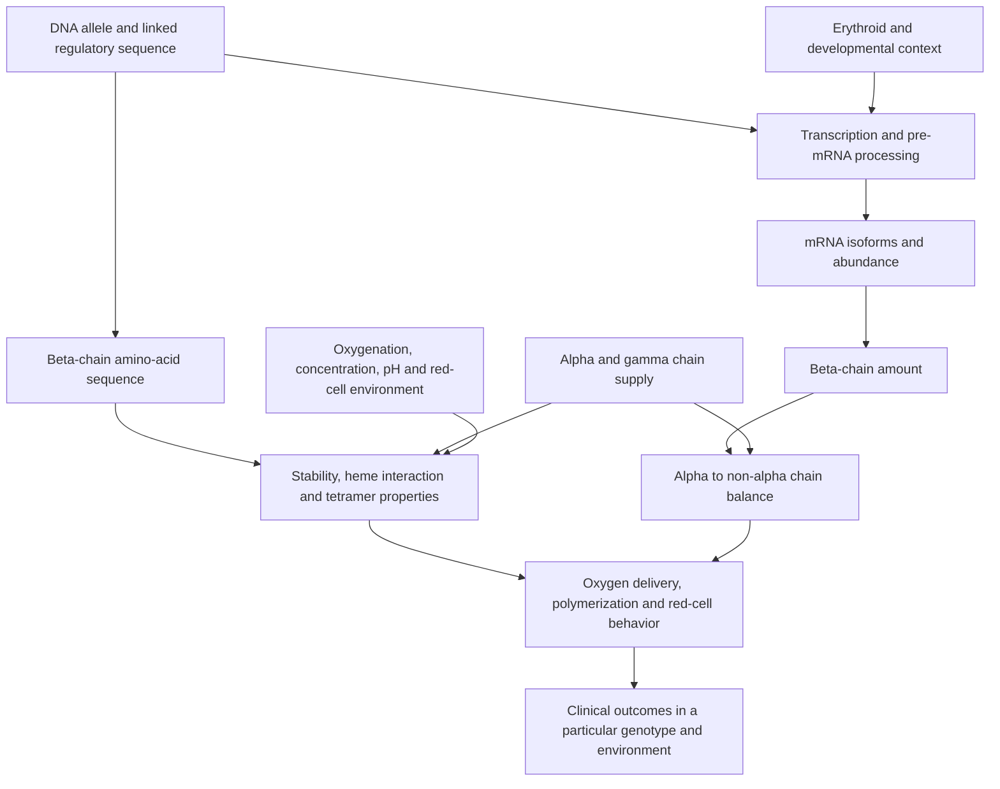

# HBB as a tractable case study of human genome function

## Goal and evidence boundary

Recover the chain **reference DNA → spliced transcript → translated protein →
candidate molecular effects**, confront it with the public HBB assertions already
in this workspace, and state which observations could falsify the remaining
explanations. The immediate success criteria are exact reference reconstruction,
correct known-variant controls, an exhaustive and explicitly bounded SNV map,
and an evidence-quality audit. A clinical prediction score is not the definition
of understanding.

This is an **exploratory research record**. The 54-record ClinVar fixture and its
former held-out partition have been inspected by the research agents. They can
support descriptive analyses and software checks, but not a new claim of blind
validation. The next independent evaluation requires a separately frozen protocol; see
`docs/` for the protocol developed alongside this research record. Nothing below establishes a new
biological discovery or a complete model of the human genome.

Statements are separated into three categories:

- **Established background:** literature or reviewed database assertions, with
  citations. These remain empirical claims with source-specific limits.
- **Computational deductions:** consequences of a named reference, coordinate
  convention, transcript model, genetic code or already observed dataset.
- **Untested hypotheses:** candidate explanations requiring discriminating data.

## 1. Establish the representation before interpreting a variant

HBB is on the minus strand of chromosome 11. Reading the forward genomic string
as though it were the transcript reverses both the order and meaning of changes.
The reference bundle uses GRCh38 chromosome `NC_000011.10`, transcript
`NM_000518.5` and protein `NP_000509.1`. The independently reconstructed reference
must agree with these named sequences before annotations are accepted. [S01–S03]

| Component | Reference-specific computational contract |
| --- | --- |
| Transcript locus | `[5225463, 5227071)`, zero-based half-open, 1,608 genomic bases |
| Exon 1 in transcription order | `[5226929, 5227071)`, 142 bases |
| Exon 2 | `[5226576, 5226799)`, 223 bases |
| Exon 3 | `[5225463, 5225726)`, 263 bases |
| Spliced transcript | 628 bases after reverse complement and exon joining |
| 5′ UTR / CDS / 3′ UTR | 50 / 444 / 134 bases |
| Translation | 147 amino acids followed by a stop; the CDS includes that stop codon |

The genomic CDS bounds span introns; slicing the whole bounded genomic interval
does not produce the CDS. The coding contributions of the three exons are
92, 223 and 129 nucleotides, respectively. Intron 1 therefore interrupts codon 31
after its second nucleotide; intron 2 falls between complete codons. These are
reference-derived calculations, not empirical evidence for the effect of any
mutation. [S02]

Reviewed UniProt P68871 includes the initiating methionine at residue 1 and
annotates its removal; the mature beta chain is residues 2–147. Consequently,
classical beta-chain residue numbering is one lower than the Met-inclusive
RefSeq/UniProt numbering used by this toolkit. HbS is classical beta6 Glu→Val
but `NM_000518.5:c.20A>T / p.Glu7Val`. HbC is `c.19G>A / p.Glu7Lys`. Confusing
these systems creates a false disagreement. [S03, S04]

## 2. The useful model has several distinct molecular outputs

A compact qualitative dependency model is:

These arrows summarize established qualitative relationships, not a fitted
causal graph or a set of quantitatively verified equations. HBB sequence alone
does not determine every node. Relevant distinct endpoints include correctly
spliced RNA fraction, RNA abundance, beta-chain production, protein stability,
oxygen-affinity curves, polymerization behavior, hemolysis and vascular outcomes.
Collapsing them into a single “functional effect” discards information. [S01,
S03, S05, S06, S14]

### Protein function is more than “missense”

Adult HbA has two alpha and two beta subunits. Each beta subunit has a heme
environment; reviewed UniProt annotates distal His64 and proximal His93 in
Met-inclusive numbering. The proximal histidine directly coordinates heme iron;
the distal histidine contributes to the environment of the bound ligand and is
not a second direct iron ligand. The same entry also records beta-chain residues involved
in 2,3-bisphosphoglycerate binding. A residue can influence the heme environment,
subunit interfaces, allosteric equilibria or stability rather than simply abolish
the protein. Linear proximity to a binding residue is not a demonstrated
three-dimensional interaction or a validated pathogenicity score. [S01, S03]

HbS illustrates a specific qualitative defect: the beta6/Met-inclusive Glu7
substitution enables deoxygenated HbS to polymerize into fibers. Whether a red
cell sickles depends on polymerization kinetics relative to transit time and on
the intracellular composition and environment. Therefore, “Glu→Val” does not
alone specify a patient's phenotype, and a codon translator does not calculate
a polymerization rate. [S04, S05]

Two variants in this fixture illustrate different molecular interpretations
hidden by the same binary clinical label:

| Reference-inclusive protein change | Source-backed context | What the current fixture does not measure |
| --- | --- | --- |
| p.Asn109Lys | Reviewed UniProt identifies Hb Presbyterian, with decreased oxygen affinity and instability; the cited original report describes low oxygen affinity. [S03, S17] | The oxygen curve, chain stability, inheritance context and phenotype for these exact submitted alleles |
| p.His98Gln | Reviewed UniProt identifies Hb Malmö with increased oxygen affinity. [S03] | Quantitative affinity, erythrocytosis penetrance or individual clinical outcome |

The first distinction is about the *direction and type* of protein behavior,
not whether one source's “pathogenic” label is intrinsically more certain than
another's. The UniProt annotations are reviewed assertions; the toolkit has not
reproduced these historical biochemical experiments.

### Dosage defects are a different route

Beta-thalassemia is fundamentally associated with reduced or absent beta-chain
production and the resulting imbalance with alpha-chain supply. A variant may
affect transcription, splice-site use, RNA stability, translation or protein
stability. The labels beta-plus and beta-zero describe reduced versus absent
production, not a unique DNA consequence class. [S01, S03, S06]

A “stop gained” label is not sufficient to assign an RNA outcome. Beta-globin
has been a model for RNA surveillance: early work demonstrated rapid loss of
thalassemic beta-globin RNA, and later experiments showed that the position of a
premature stop alone does not fully determine nonsense-mediated decay. Different
experimental studies emphasize initiation proximity and downstream reinitiation.
This toolkit does not adjudicate those mechanisms from sequence alone. It should
record a premature stop and its context, not promote it automatically to
“complete NMD” or a specific clinical severity. [S14–S16, S18]

A core splice-motif change is also only a candidate mechanism. Conversely,
unchanged canonical ±1/±2 intronic bases do **not** imply unchanged splicing.
The classic beta-plus-thalassemia intron study demonstrated a point mutation
creating an additional 3′ splice site and abnormal RNA processing in its
experimental context. Cryptic sites, branch-point/polypyrimidine sequence and
exonic regulatory elements can matter beyond the small core motif window. [S07]

## 3. HBB function depends on the rest of the genome and on cell state

| Component | Mechanistic relevance | Evidence and limitation |
| --- | --- | --- |
| HBA1 / HBA2, chromosome 16 | Alpha-chain supply changes the chain imbalance caused by insufficient beta production. | Human cohort observations associate alpha deletions and triplication with different beta-thalassemia phenotypes. Direction and magnitude depend on genotype and endpoint. [S06, S13] |
| HBG1 / HBG2, beta-globin cluster | Gamma-chain expression produces fetal hemoglobin with alpha chains; fetal/adult globin balance changes the molecular environment in which HBB variants act. | Reviewed globin biology and HbF studies support the relationship; the present HBB-only fixture contains no measured HbF. [S05, S08, S09] |
| BCL11A, chromosome 2 | Developmental erythroid regulation of fetal globin expression. | Association with HbF/phenotype [S09], expression perturbation in adult erythroid cells [S08], and enhancer loss-of-function work [S11] support different parts of the chain. Association is not by itself the perturbational evidence. |
| HBS1L–MYB intergenic region, chromosome 6 | Distal regulatory variation can alter erythroid enhancer interactions and MYB expression, affecting HbF and erythroid traits. | Stadhouders et al. connect noncoding variants, transcription-factor binding and long-range MYB regulation in the studied systems. It does not mean every nearby noncoding variant has the same effect. [S10] |

In sickle cell disease, an alpha-globin deletion is not a universal scalar
“improvement” to every clinical outcome. For example, the cited human study
measured reduced severity of hemolytic anemia and changes in cellular
hemoglobin properties; that specific endpoint does not establish the direction
of every vascular or organ outcome. “Modifier” must retain the affected endpoint,
genotype and setting. [S12]

This is why the human genome is not adequately reverse engineered by assigning
one consequence label to each position. Protein composition, regulation in
different cell types and developmental stages, linked alleles and environmental
state are part of the explanatory model. HBB is unusually well studied; even
here the reference sequence is only the first layer of understanding.

## 4. What this workspace actually observes

The frozen source fixture has 54 variants: 34 intronic, 10 missense, six
synonymous, two UTR, one stop-related and one “other” record under its curated
grouping. There are 44 benign/likely-benign and ten pathogenic/likely-pathogenic
assertions. Those are counts of **curated assertions**, not functional
measurements. The source manifest hashes were checked before this analysis.
See the [ClinVar evidence audit](clinvar-audit.md) for review status, condition
missingness and partition contamination.

The broad missense group contains both labels: eight pathogenic/likely
pathogenic and two benign/likely benign. The two UTR records also have opposite
labels. Therefore a deterministic classifier that uses **only** this group
label cannot agree with every assertion in the pooled explored fixture: at
least two missense records and one UTR record must disagree. The best possible
agreement under that information restriction is at most 51/54 on these same
observed records. This is a counting argument about lossy features and selected
labels, not an independently validated accuracy estimate or a biological law.

Several particularly important limits follow.

1. **No canonical splice-class row is represented.** Thirty-four intronic
   benign/likely-benign assertions do not establish that intronic variants are
   generally harmless or that the splice mechanism has been validated.
2. **Coverage is sparse.** The transcript span has 1,608 positions and thus 4,824
   possible single-base substitutions, of which 1,332 affect the 444 CDS bases.
   Only 53 fixture variants lie in this span, including 17 coding records. The
   54th lies upstream of the annotated transcript. The denominators are defined
   reference-based universes, not counts of observed human variation.
3. **The familiar controls are missing.** HbS, HbC and substitutions at annotated
   heme-interaction His64/His93 are not in these 54 records. A good demo score does not
   show coverage of those mechanisms.
4. **Nearby is not independent.** A position-disjoint split does not exclude
   shared protein context, source cohorts, submitting organizations or curation.
   The already explored former holdout must not become “new” validation after
   we redesign features.
5. **Clinical truth is not measured effect.** The lone original test-set false
   positive, p.His78Leu, is a likely-benign, single-submitter assertion without a
   specified condition. It is a broad-feature model gap, not a demonstrated
   contradiction between independently measured experiments.

### Two concrete examples of interpretation discipline

- `c.-43C>T` is within this transcript's 50-base **5′ UTR**. “Before the ATG”
  does not automatically mean “promoter.” Its reported clinical classification
  does not distinguish effects on transcription, RNA stability or translation.
- `c.442T>G / p.Ter148Glu` changes the first base of the termination codon.
  Computing the amino acid at that codon does not identify the complete new
  protein. Extension length requires downstream in-frame sequence and another
  termination codon; RNA/protein behavior remains unmeasured.

## 5. A falsifiable research agenda

Machine-readable definitions are in [hbb-hypotheses.json](hbb-hypotheses.json).
The agenda is deliberately small enough to execute with the present toolkit.

| ID | Computable question now | What would still require independent evidence |
| --- | --- | --- |
| HBB-REF-01 | Does minus-strand exon joining recover the named transcript/protein and correctly map HbS/HbC? | Independent correctness of the chosen reference and clinical interpretation |
| HBB-ANNOT-02 | Do independently translated coding changes agree with the frozen transcript-specific assertions, and where are dual coding/splice contexts? | RNA/protein assays for a claimed mechanism; alternative transcript and disease context |
| HBB-EQUIV-03 | Do distinct DNA alleles `c.327C>A` and `c.327C>G` yield the same amino-acid replacement? | Whether RNA processing, expression, haplotypes or clinical effects are equivalent |
| HBB-JUNCTION-04 | Is `c.92G>T / p.Arg31Met` both a coding change and an exonic splice-boundary candidate? | Whether canonical splicing is actually perturbed in an appropriate erythroid context |
| HBB-COVERAGE-05 | Which positions, mechanism classes and assertion qualities are absent from the fixture relative to the saturation map? | An independently selected functional benchmark covering those gaps |

These questions test *representation, information content and candidate
mechanisms*. They do not authorize a causal conclusion from a ClinVar category.
For predictive research, freeze a fresh endpoint, cohort/assay grouping, model,
baseline and decision rule before evaluating any new observations.

## 6. What would most improve the explanatory model

The next evidence should separate quantities currently conflated:

- **RNA:** correctly spliced fraction, isoform identity and abundance, with a
  named erythroid/developmental context. This would discriminate coding-only
  from additional RNA-processing explanations for boundary variants.
- **Protein:** beta-chain production and stability, distinct from hemoglobin
  assembly and from oxygen affinity.
- **Hemoglobin behavior:** oxygenation and polymerization endpoints in a named
  composition/environment, rather than a generic pathogenicity bit.
- **Organism context:** phase/zygosity, HBA copy number, gamma-globin expression,
  modifier alleles and the clinical phenotype actually being predicted.

This is a specification of needed evidence, not a laboratory protocol. A useful
model should sometimes answer “the sequence consequence is known, but the
downstream effect is unresolved.” That answer is more informative than a
confident binary classification unsupported by an identified endpoint.

## 7. An independently sourced functional follow-on is now identified

The [HBB promoter MPRA score set, MaveDB urn:mavedb:00000018-a-1](https://www.mavedb.org/score-sets/urn:mavedb:00000018-a-1),
from Kircher et al. [S19], offers a different endpoint from the ClinVar assertions:
reporter-expression effects in the recorded HEL92.1.7 cell context. It can test a
regulatory-sequence model after its mapping, reuse terms and prospective protocol
are verified. Reporter activity is not endogenous HBB expression, oxygen affinity,
hemoglobin polymerization or clinical pathogenicity.

The paper describes three independent cultures transfected with the same
constructed library for each MPRA experiment. Additional independently
constructed libraries are described for LDLR and SORT1, not HBB. The combined
regression uses the transfection replicates and barcode-derived RNA/DNA counts;
these do not constitute independent studies or automatically independent variant
samples. Article text is CC BY4.0; a separate score-set CC0 label must be checked
on its own terms. No HBB score values were inspected in preparing these
mechanistic hypotheses. [S19]

## Sources and access notes

[S01] [NCBI Gene 3043: HBB](https://www.ncbi.nlm.nih.gov/gene/3043).
The ESummary response is retained in `sources/ncbi-gene-3043.json`.

[S02] [Reference bundle](../datasets/hbb-reference/manifest.json):
GRCh38 `NC_000011.10`, `NM_000518.5` and `NP_000509.1`, with raw UCSC/NCBI source
provenance and explicit zero-based coordinate conversion. Exact reconstruction
is a computational consistency check; the sources can share RefSeq ancestry.

[S03] [Reviewed UniProt P68871](https://www.uniprot.org/uniprotkb/P68871/entry),
entry version 219, sequence version 2, annotation update 2026-09-02. Complete JSON
is retained in `sources/uniprot-P68871.json`. UniProt data are attributed under
[CC BY 4.0](https://www.uniprot.org/help/license).

[S04] Ingram VM. *Gene mutations in human haemoglobin: the chemical difference
between normal and sickle cell haemoglobin.* Nature (1957).
[PMID 13464827](https://pubmed.ncbi.nlm.nih.gov/13464827/);
[doi:10.1038/180326a0](https://doi.org/10.1038/180326a0).

[S05] Eaton WA, Bunn HF. *Treating sickle cell disease by targeting HbS
polymerization.* Blood (2017).
[PMID 28385699](https://pubmed.ncbi.nlm.nih.gov/28385699/);
[doi:10.1182/blood-2017-02-765891](https://doi.org/10.1182/blood-2017-02-765891).

[S06] Galanello R, Origa R. *Beta-thalassemia.* Orphanet J Rare Dis (2010).
[PMID 20492708](https://pubmed.ncbi.nlm.nih.gov/20492708/);
[doi:10.1186/1750-1172-5-11](https://doi.org/10.1186/1750-1172-5-11).
Used for biological mechanisms, not current treatment recommendations.

[S07] Busslinger M, Moschonas N, Flavell RA. *Beta + thalassemia: aberrant splicing
results from a single point mutation in an intron.* Cell (1981).
[PMID 6895866](https://pubmed.ncbi.nlm.nih.gov/6895866/);
[doi:10.1016/0092-8674(81)90412-8](https://doi.org/10.1016/0092-8674(81)90412-8).

[S08] Sankaran VG et al. *Human fetal hemoglobin expression is regulated by the
developmental stage-specific repressor BCL11A.* Science (2008).
[PMID 19056937](https://pubmed.ncbi.nlm.nih.gov/19056937/);
[doi:10.1126/science.1165409](https://doi.org/10.1126/science.1165409).

[S09] Uda M et al. *Genome-wide association study shows BCL11A associated with
persistent fetal hemoglobin and amelioration of the phenotype of
beta-thalassemia.* PNAS (2008).
[PMID 18245381](https://pubmed.ncbi.nlm.nih.gov/18245381/);
[doi:10.1073/pnas.0711566105](https://doi.org/10.1073/pnas.0711566105).

[S10] Stadhouders R et al. *HBS1L-MYB intergenic variants modulate fetal hemoglobin
via long-range MYB enhancers.* J Clin Invest (2014).
[PMID 24614105](https://pubmed.ncbi.nlm.nih.gov/24614105/);
[doi:10.1172/JCI71520](https://doi.org/10.1172/JCI71520).

[S11] Canver MC et al. *BCL11A enhancer dissection by Cas9-mediated in situ
saturating mutagenesis.* Nature (2015).
[PMID 26375006](https://pubmed.ncbi.nlm.nih.gov/26375006/);
[doi:10.1038/nature15521](https://doi.org/10.1038/nature15521).

[S12] Embury SH et al. *Concurrent sickle-cell anemia and alpha-thalassemia:
effect on severity of anemia.* NEJM (1982).
[PMID 6172710](https://pubmed.ncbi.nlm.nih.gov/6172710/);
[doi:10.1056/NEJM198202043060504](https://doi.org/10.1056/NEJM198202043060504).

[S13] Shaw J et al. *Alpha globin gene alterations modifying the phenotype of
homozygous beta thalassaemia.* eJHaem (2024).
[PMID 38895064](https://pubmed.ncbi.nlm.nih.gov/38895064/);
[doi:10.1002/jha2.923](https://doi.org/10.1002/jha2.923).

[S14] Peixeiro I, Silva AL, Romão L. *Control of human beta-globin mRNA stability
and its impact on beta-thalassemia phenotype.* Haematologica (2011).
[PMID 21357703](https://pubmed.ncbi.nlm.nih.gov/21357703/);
[doi:10.3324/haematol.2010.039206](https://doi.org/10.3324/haematol.2010.039206).

[S15] Inácio A et al. *Nonsense mutations in close proximity to the initiation
codon fail to trigger full nonsense-mediated mRNA decay.* J Biol Chem (2004).
[PMID 15161914](https://pubmed.ncbi.nlm.nih.gov/15161914/);
[doi:10.1074/jbc.M405024200](https://doi.org/10.1074/jbc.M405024200).

[S16] Neu-Yilik G et al. *Mechanism of escape from nonsense-mediated mRNA decay
of human beta-globin transcripts with nonsense mutations in the first exon.*
RNA (2011).
[PMID 21389146](https://pubmed.ncbi.nlm.nih.gov/21389146/);
[doi:10.1261/rna.2401811](https://doi.org/10.1261/rna.2401811).

[S17] Moo-Penn WF et al. *Hemoglobin Presbyterian: beta108 (G10) asparagine leads
to lysine, A hemoglobin variant with low oxygen affinity.* FEBS Lett (1978).
[PMID 668922](https://pubmed.ncbi.nlm.nih.gov/668922/);
[doi:10.1016/0014-5793(78)80720-0](https://doi.org/10.1016/0014-5793(78)80720-0).
Only bibliographic/title metadata were returned for this primary report;
the additional instability annotation comes from reviewed UniProt.

[S18] Maquat LE et al. *Unstable beta-globin mRNA in mRNA-deficient beta o
thalassemia.* Cell (1981).
[PMID 6101206](https://pubmed.ncbi.nlm.nih.gov/6101206/);
[doi:10.1016/0092-8674(81)90396-2](https://doi.org/10.1016/0092-8674(81)90396-2).

[S19] Kircher M et al. *Saturation mutagenesis of twenty disease-associated
regulatory elements at single base-pair resolution.* Nature Communications
(2019). [PMID 31395865](https://pubmed.ncbi.nlm.nih.gov/31395865/);
[doi:10.1038/s41467-019-11526-w](https://doi.org/10.1038/s41467-019-11526-w).
Full text and its CC BY4.0 permissions were read through Europe PMC
[PMC6687891](https://pmc.ncbi.nlm.nih.gov/articles/PMC6687891/).

Literature bibliographic metadata and access extent are retained in
`sources/publications.json`; source-response hashes and retained-file hashes are
in `sources/manifest.json`. Abstract-level evidence is distinguished from
full-text access. Original paper abstracts/full text are not redistributed.
NCBI Bookshelf requests for the Sickle Cell Disease and Beta-Thalassemia
GeneReviews chapters returned browser challenges rather than chapter text;
those chapters were not treated as retrieved supporting evidence.
