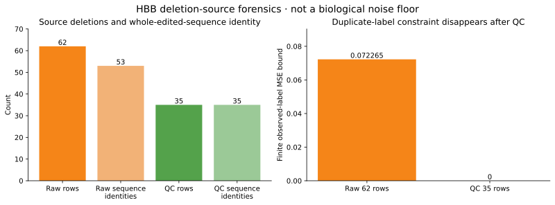
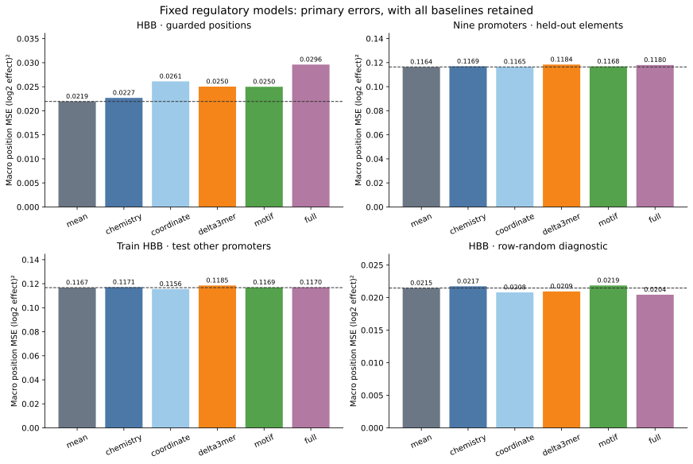
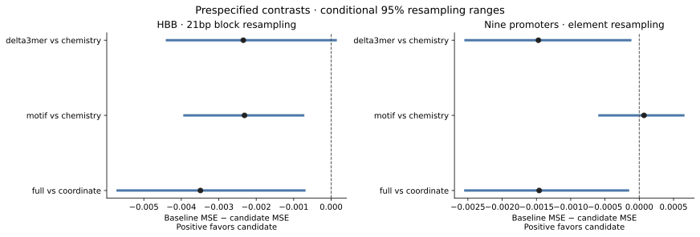
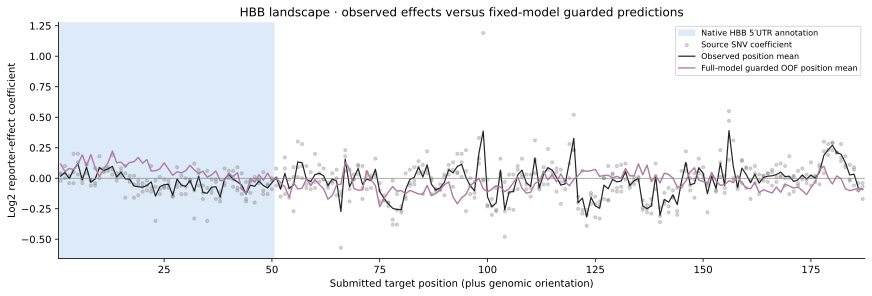
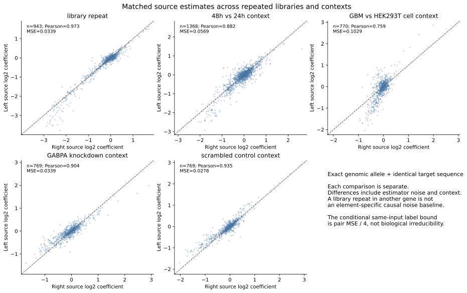

# Sequence, context and source quality in a human regulatory assay

## Research question

Can a small, explicit sequence model predict regulatory variant effects beyond
simple baselines on genuinely held-out positions or promoter elements? Which
apparent limits instead arise from source identity, measurement quality, or
numerical computation?

We completed a frozen exploratory study, a separate source-forensic investigation,
independent Rust/Python implementations, and a separately specified post-hoc
numerical sensitivity analysis. The principal predictive result is negative.
The useful new results of this reanalysis are precise, testable statements about
this dataset and these models, not a demonstrated new biological mechanism.
The [novelty review](regulatory-novelty-review.md) identifies substantial prior art.

## Findings at a glance

| Finding | Evidence | Claim boundary |
| --- | --- | --- |
| The fixed sequence models do not outperform the mean baseline across nine held-out promoters | Complete six-model evaluation, all planned contrasts, independent numerical implementation | Applies to these features, fixed penalty and selected same-study assays; not all DNA models |
| HBB's apparent row-random full-model advantage reverses under a 20bp guard | All split memberships and predictions retained | Different split difficulty and shared context both change; not a pure causal estimate of leakage |
| Raw deletion identity can manufacture an apparent prediction floor that disappears after quality filtering | Original-source bijection, whole-edited-sequence identities, exact Decimal crosscheck | Source-estimate inconsistency; not biological irreducibility |
| Tiny prediction differences can change exact-rank metrics | 131,112 predictions agree within 7.73e−12, but 26 of 240 raw Spearman checks fail | Primary losses reproduce; full frozen secondary-rank reproduction remains failed |
| Identical allele inputs have different source coefficients across experimental contexts | Five prespecified matched comparisons, independently reproduced | Includes estimation noise and context; does not assign a causal biological component |

## 1. A source discrepancy, then a quality control that changes its meaning

The frozen MaveDB HBB download has 62 literal equality descriptions. All 62
reconcile one-to-one to one-base deletion rows in the author's original,
service-hash-verified 2018 table. All 623 total rows match position/allele, score,
tags, DNA and RNA counts; source p-values reconcile to database rounding.
Author documentation independently defines the deletion notation.

Those 62 rows produce **53 distinct altered sequences**, not 62 distinct physical
alleles. Nine repeat-equivalent pairs have differing fitted coefficients. Their
within-identity sum of squared deviations is **4.480450**, giving a finite
observed-label MSE bound of **0.0722653 over the 62 raw rows** for a predictor
that assigns one value per identical altered sequence.

The adversarial control is decisive: **every duplicate pair has one row below
10 tags**. Applying the study's preexisting minimum-tag rule leaves **35 rows
and 35 distinct sequences**; this duplicate-identity constraint becomes zero.
The raw number is therefore not evidence for a biological noise floor.
The database's 84 rounded-zero p-values likewise must not be read as literal
zero probabilities; the original source values are nonzero.



The general legacy deletion/equality issue was publicly reported before this
work. The exact HBB reconciliation and identity/QC accounting are reproducible
case-specific results; their global novelty is unestablished. The conversion
stage that introduced the representation discrepancy remains unknown. Original
snapshots are unchanged, and arbitrary equality rows are not reinterpreted.
See the [complete forensic report](regulatory-forensics.md),
[62 source-anchored mappings](regulatory-forensics.json), and
[independent sequence/Decimal verifier](../scripts/independently_verify_deletion_identity.py).

## 2. The predictive test fails the useful baseline comparison

The source cohort has **18,468 rows across 15 score sets**: nine primary
non-HBB promoter elements, five validation-only shared-locus contexts/repeats,
and previously explored HBB. Reference-validated SNVs number 15,699; fixed
quality criteria retain 15,563 across all roles. The primary analysis uses
**10,365 SNVs at 3,485 positions**. Incomplete positions retain every eligible
allele.

Before new score acquisition, the protocol fixed six models:

- Training mean.
- Twelve directed mutation identities.
- Mutation identity plus normalized position and its square.
- Mutation identity plus 64 signed overlapping 3-mer-count changes.
- Mutation identity plus four versioned JASPAR motif-score changes.
- Their full combination.

Ridge uses summed squared error plus alpha10 L2 penalty, an unpenalized intercept,
and training-only population-SD scaling. Counts and p-values are quality/source
fields, never predictive covariates. No assay/cell identifier or test-outcome
normalization is learned. Motif scores are prior sequence-similarity features,
not occupancy or binding measurements.

Primary folds hold out one of nine promoter elements and train on the other
eight. HBB and validation-only datasets never enter those fits. Errors first
average alleles within position, then positions within assay, then assays equally.

| Model | Primary macro position MSE |
| --- | ---: |
| Mean | **0.116392187** |
| Chemistry | 0.116899210 |
| Coordinate | 0.116528763 |
| Delta 3-mer | 0.118370897 |
| Four motifs | 0.116829487 |
| Full | 0.117988875 |

MSE units are squared log2 reporter-effect coefficients. These are published
additive-model estimates from plasmid MPRA, not endogenous gene abundance or
clinical risk. No fitted model beats the mean baseline overall. Training on HBB
alone and transferring to the other elements also yields no convincing gain.



The motif model improves on chemistry by only **0.00006972** MSE, roughly 0.06%.
Its conditional element-bootstrap range is **[−0.00058044, +0.00064285]** and
crosses zero. A favorable raw spatial-control tail of 0.01 becomes 0.03 under
within-family Holm and 0.06 under six-comparison Bonferroni; the motif model
still loses to the mean. Neither the tail nor the small contrast establishes
practical superiority or a discovered regulatory mechanism.



All 99 chemistry-stratified rotations and 2,000 common-draw resamples were retained.
These controls require stationarity/experimental assumptions not established by
the assays. They are robustness diagnostics, not calibrated biological p-values.
With 99 controls, six-comparison Bonferroni cannot resolve a plus-one tail below
0.05. We did not increase repetitions after seeing the result.

## 3. A split-dependent apparent improvement

For HBB, the source target has 187 positions and 561 SNVs. Five contiguous test
blocks hold all alleles at a position together. A train/test center separation
of at least 21bp makes radius10 feature supports disjoint. The guarded full
model has MSE **0.029609654**, versus **0.021933886** for its mean baseline:
about 35% worse.

The deliberately row-random diagnostic gives full-model MSE **0.020436205**
versus **0.021462133** for its mean baseline, an apparent 4.8% improvement.
This reverses the useful conclusion under the harder split. Shared position
information, overlapping sequence support and different distribution difficulty
all contribute; the difference cannot be attributed solely to leakage.



The target reference is stored plus-genomic. The deposited primer/backbone
evidence supports a native-minus HBB insert upstream of luciferase. That does
not establish the exact reporter transcript start or RNA isoform. Native
5-prime-UTR annotation alone does not justify a uAUG or RNA-processing mechanism.
See the [construct/literature review](regulatory-literature.md).

## 4. Context is part of the observation contract

Exact genomic alleles and identical submitted reference targets match across
five prespecified comparisons. Quality criteria are identical to modeling.

| Relationship | Matched variants | Pearson | Coefficient MSE | Conditional same-input label bound |
| --- | ---: | ---: | ---: | ---: |
| LDLR library repeat | 943 | 0.97265 | 0.0339334 | 0.00848335 |
| PKLR 48h versus 24h | 1,368 | 0.88203 | 0.0569433 | 0.01423584 |
| TERT GBM versus HEK293T | 770 | 0.75903 | 0.1028804 | 0.02572010 |
| TERT GABPA knockdown versus control | 769 | 0.90366 | 0.0338541 | 0.00846352 |
| TERT scrambled-control context | 769 | 0.93516 | 0.0277620 | 0.00694051 |

For two source labels a,b on the same input, the best single fitted value is their
mean; minimum squared loss over the two observations is their squared difference
divided by four. This is finite observed-label algebra. It includes measurement
noise, processing and experimental context; it is not a population Bayes-error
or biological irreducibility estimate.



Pairs are reported separately. Reused TERT datasets are not pooled as independent
experiments. The optional inventory bound deduplicates source accessions. The
LDLR repeat cannot supply a TERT-specific noise estimate. Known TERT/context
biology and LDLR repeat correlation appear in prior literature; those concepts
are not discoveries here.

## 5. Independent computation exposed a numerical failure

Rust and independently written NumPy/SciPy code agree on:

- All **131,112 predictions**, maximum absolute difference **7.729e−12**, under
  the frozen 1e−7 prediction tolerance.
- All 84 train/test/guard lists and 168 fitted preprocessing/coefficient vectors.
- All primary errors, 2,000 bootstrap draw tables/statistics, and 99 spatial-null
  refits, typically within about 1e−14.
- All five context-pair counts, metrics and finite source-label bounds.

The **full frozen comparison remains failed**: 26 of 240 secondary exact-Spearman
checks do not reproduce. Initial attempts exposed constant-vector and reduction
artifacts. Exact source-decimal position means and identical-feature prediction
reuse remove those defects, but near-machine-precision coefficient asymmetries
still split theoretical ties.

An explicit example has 36 HBB A>G effects and 36 A>T effects, both with exact
source sum 2/5 and mean 1/90. Independent floating fits can separate symmetric
coefficients by about 5e−18. A resulting rank difference is not regulatory biology.
The identical-vector rank algorithms themselves agree.

A **separate post-hoc protocol**, fixed before its diagnostic execution, reports
all five prediction grids [1e−12, 1e−10, 1e−8, 1e−6, 0.01]. Every grid reproduces
240/240 metrics, while raw exact reproduces 214/240. No grid is selected and
none retroactively repairs frozen v1. Coarsening changes the rank estimand;
the coarsest level changes some correlations by about 0.109.
See [independent replication](independent-regulatory-replication/README.md) and
[the numerical sensitivity review](rank-sensitivity-review.md).

## Reproduction and retained evidence

The [frozen study protocol](../experiments/regulatory-prediction-v1.json),
[human-readable methods](../experiments/regulatory-prediction-v1.md),
[statistical review](regulatory-statistical-review.md), and
[novelty ledger](regulatory-novelty-review.md) define the claims.
Raw source bytes, licensing, reference reconciliation, inclusion/exclusion
counts, feature vocabularies, fold identities, fitted means/scales/coefficients,
predictions, resamples, controls, source corrections and failed attempts are
retained.

From the repository root:

```bash
bash scripts/setup.sh
bash scripts/setup_research.sh
source scripts/research-env.sh
bash scripts/check.sh
bash scripts/check_study.sh runs/<new-prefix>
```

The last command finishes figures and diagnostics but returns **2** when the
frozen secondary-rank comparison remains failed. This is disclosed, not turned
into a passing full-reproduction claim. Core software/source tests and verified
primary numerical claims remain distinct.

The [published artifact snapshot](results/regulatory-v1/README.md) provides full
compressed results, independent replay material, comparisons, numerical
supplement and figures. It can be audited without refitting; hashes establish
integrity relative to commitments, not source authentication or biological truth.

## What remains scientifically open

These are selected promoters from one study, with shared processing and mixed
cell contexts. Four motif priors and short k-mers are a small hypothesis class.
Their failure does not imply DNA contains no predictive information or that
larger/context-aware models cannot work. Reporter coefficients do not directly
measure endogenous chromatin, transcriptional initiation, RNA fate, protein
behavior or clinical outcomes.

The next falsifiable goal is context-aware prediction evaluated with appropriate
same-element repeated measurements and new experimental contexts, after separating
representation and support artifacts. Independent endogenous observations are
needed to test biological mechanisms. No new biological mechanism or globally
first finding is claimed from the present work.
