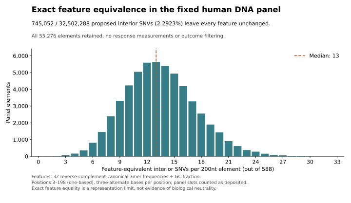

# Exact limits of the composition model for single-base edits

An exhaustive, outcome-free analysis finds **745,052 single-base edit opportunities
(2.2923%)** that leave every feature of the current composition model unchanged
across the existing 55,276-element panel. Every fixed linear model on these
features must assign those pairs the same ideal score, whatever its coefficients.
This is a quantified limitation of the representation. These proposed edits
have not been measured in a new experiment, and feature equality does not imply
biological neutrality.

## Question and exact representation

The [activity study](context-activity-study.md) predicts whole-fragment reporter
activity using 32 reverse-complement-canonical overlapping 3mer frequencies and
GC fraction. Its success on fragments does not establish accuracy for mutations.
For a 200nt fragment, the denominators are 198 and 200. A fixed standardized
linear fit can be written as a weighted sum of counts plus an intercept by
absorbing those denominators and its saved training scales into the coefficients.
Training means and intercepts cancel in a paired mutation difference.

An interior single-base substitution changes only the three overlapping trimers
containing that base and the GC numerator. Its complete feature change therefore
depends only on the original five-base neighborhood and alternate base. More
distant sequence and the interior position cannot change that feature difference.
Positions 2–197, zero-based, are interior in this analysis; boundary changes
have fewer affected windows.

## Complete local enumeration

The [independent exact audit](variant-locality/exact-audit-v1/summary.json)
enumerates all 1,024 oriented five-base strings and three alternate central bases:
3,072 directed edits, or 1,536 reverse-complement pairs. They produce **1,405
distinct exact 33-integer feature changes**. No model coefficients, response
measurements or significance filters enter this calculation.

Exactly **64 directed edits**, or 32 reverse-complement pairs, have an all-zero
feature change. In this complete enumeration, these are precisely the edits whose
mutated five-base string is the reverse complement of its original. The four
outer bases form complementary pairs and the center changes to its complement.
For example, `AAATT → AATTT` changes A to T while preserving the canonical
trimer spectrum and GC count. The unchanged surrounding sequence can be arbitrary.

The audit also checks 786,432 outer-flank combinations, every local class embedded
in a 200nt fragment, all reverse-complement identities and all 589,824 double
edits at distance three. Its complete vectors, equivalence classes, examples,
implementation and hash manifest are retained. Fresh-path replay reproduced the
published files byte-for-byte.

## Exhaustive scan of the existing panel

The independent [DNA-only panel scan](variant-locality/panel-scan-v1/README.md)
retains all 55,276 original records. Each contributes 196 interior positions and
three alternate bases: **32,502,288 opportunities**. All 3,072 directed local
classes occur. There are **745,052 exact zero-feature changes**, or 2.2923063%.
The number per record has median 13, interquartile range 11–16 and range 0–33;
55,270 records have at least one and six have none.

These are assay-panel slots, not genomic-unique variants, observed human allele
frequencies or mutation-rate-weighted opportunities. The source contains 55,276
distinct DNA strings and 55,275 reverse-complement identities. No deduplication,
outcome filtering or response fitting was performed. Direct whole-fragment
feature recomputation agrees with the local integer calculation for a real
representative of every observed local class. Exact allele-swap and
reverse-complement checks also pass.

The [standalone figure bundle](variant-locality/figures/README.md) includes the
complete histogram counts, SVG/PNG and source/implementation hash bindings.

## Interactions the model cannot express

For two substitutions separated by at least three positions, no trimer contains
both edited sites. Their mixed feature difference is exactly zero:

`F(double) − F(first) − F(second) + F(reference) = 0`.

Every fixed linear predictor on these features therefore has zero ideal predicted
interaction at those distances. The restriction holds for arbitrary sequence and
weights, including cell-specific coefficients. It is not a claim that molecular
interactions stop at that distance. The model has no features capable of encoding
those interactions. At distances one and two, interaction features can be nonzero;
particular coefficient-weighted predictions can still cancel.

[VariantLocality.lean](../proofs/VariantLocality.lean) checks 21 theorems over
actual DNA, overlapping trimer windows and finite weighted sequence sums. It proves
local mutation differences, identical-neighborhood effects and distant-edit
additivity, and gives an RC-invariant distance-two counterexample. The file uses
integer weights; rational fitted-score identities follow by fixed rescaling.
That bridge and the interpretation of the deployed normalized model are stated
here, rather than claimed as a separately checked Lean theorem. IEEE floating
arithmetic can leave tiny subtraction residuals; the proof does not certify
floating-point equality or biological truth.

## Bounds for the saved fitted models

The [model-envelope audit](variant-locality/model-envelope-v1/README.md) applies
the five saved fits to every interior local edit without retraining. All 12,288
ensemble predictions and 61,440 fold contributions are retained; 86,016 numeric
comparisons with the transfer implementation agree exactly. A separate
[exact-rational review](variant-locality/numeric-review-v1/README.md) checks
24,960 ensemble predictions, including all boundary contexts, against the saved
coefficients interpreted as rational numbers. Maximum ensemble discrepancy is
below 5.56e-17; direct whole-score subtraction differs by at most 8.07e-16.

| Frozen five-fit ensemble | Maximum absolute interior SNV prediction | Maximum absolute boundary SNV prediction |
| --- | ---: | ---: |
| Shared S/A | 0.0915981 | 0.1325084 |
| HepG2 I | 0.1029483 | 0.1256045 |
| K562 I | 0.1323450 | 0.1537319 |
| WTC11 I | 0.1288580 | 0.1502152 |

These are exhaustive prediction bounds on the saved model's reporter-scale
numbers for fixed-length 200nt SNVs. Boundary edits can exceed the interior
maxima. They do not bound measured biological effects, establish cross-study
scale calibration or extend to indels, other lengths or retrained coefficients.

## Transfer tool and next falsifiable test

[predict_variant_effects.py](../scripts/predict_variant_effects.py) applies the
five saved activity fits without retraining. It verifies the caller-pinned model
manifest, source commitments and exact feature order; accepts only outcome-free
200nt SNV pairs; averages fold-specific raw-slope predictions; and checks each
against direct prediction subtraction. It subtracts integer feature counts before
normalization, so identical local changes follow identical computations and
zero-feature pairs receive zero predicted delta. Sixteen synthetic controls cover
these properties, invalid inputs, reverse complements, boundaries and cancellation.

The next [external transfer protocol](../experiments/variant-transfer-v1.json)
tests fixed predictions against signed effects from a separate study. Its source
units, exact inserted sequences, allele direction, prior-source exclusions and
whole-component population must be established before numeric outcomes are read.
Neither whole-fragment prediction nor this exact scan supplies that validation.
Bag-of-kmer locality is established mathematics; this report quantifies its
consequences for this particular feature set and fixed panel without a global
novelty or new biological mechanism claim.
