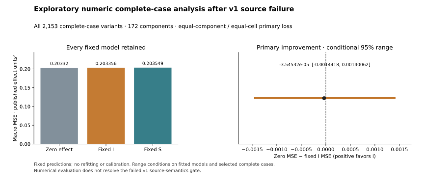
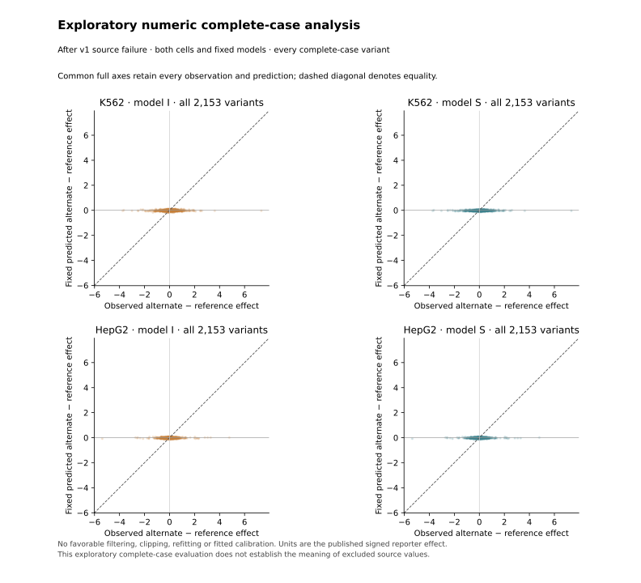

# Exploratory external test of signed variant effects

The frozen composition model shows **no observed advantage over zero-effect
prediction** on 2,153 complete-case variants across 172 previously unexposed
components in the separate Siraj 2026 reporter study. The primary macro MSE is
**0.2033556** for the fixed cell-specific model versus **0.2033201** for zero.
Zero-minus-model improvement is **−0.0000354532**, with conditional 95% range
**[−0.00144180, 0.00140062]**. The useful-transfer rule fails. The range includes
modest improvement and harm; this is not proof of an exactly zero predictive
effect or of biological neutrality.

This analysis is **exploratory after a retained source-validation failure**.
V1 stopped on an undocumented literal `NA` after 240 selected numeric cells.
V2 separately froze a numeric complete-case rule before reading the remaining
effects. It does not turn v1 into a success or claim an outcome-naive test.

## What was tested

[Siraj et al., Nature 2026](https://doi.org/10.1038/s41586-026-10121-6) report
200nt reference and alternate inserts upstream of a minimal TATA promoter/GFP.
The selected endpoint is the source DESeq2 Alt-versus-Ref by RNA-versus-DNA
interaction, in delta log2 fold-change units, separately in K562 and HepG2.
The source applies summit-shift normalization, count QC and a coverage-based
choice among libraries before publishing S4. No significance, activity, PIP or
effect-magnitude threshold selected this analysis cohort.

These effect estimates differ from the Agarwal aggregate log2(RNA/DNA) values
used to train the [whole-fragment model](context-activity-study.md). A common
log scale and cell name do not establish identical assay conditions or calibrated
cross-study effects. No gain, offset, sign, penalty or feature was fitted to the
new measurements.

The primary predictor is the arithmetic mean of all five saved matched-cell `I`
fits. For each variant/context it uses

`mean_fold sum_feature [(beta / training_scale) × (feature_alt − feature_ref)]`.

Features remain 32 RC-canonical overlapping 3mer frequencies and GC fraction;
the fixed-length denominators are 198 and 200. Intercepts and training means
cancel. Integer counts are subtracted before division. The secondary shared
`S` predictor is retained regardless of the primary result. The zero baseline
predicts no allelic effect for every case.

## Cohort, source gates and exposure

The [original report](variant-transfer-study.md),
[source packet](variant-transfer/source/README.md) and
[prior-exposure inventory](variant-transfer/prior-exposure-inventory/README.md)
retain complete source/assembly and exclusion details:

1. S2 contains 365,762 unique design IDs. There are 336,471 primary-chromosome
   A/C/G/T-only 200nt SNV pairs. Every eligible allele pair differs at index99
   and matches the Ref/Alt ID direction.
2. Whole-insert, unique single-chain-block conversion from hg19 followed by
   exact hg38 DNA validation retains 332,719 pairs. No mismatching insert is
   repaired or compared across unmatched assemblies.
3. All pairs enter fixed start-bin/overlap/parent/exact/RC/90%-homology
   components before exposure exclusions. Old training cores, ten explored
   Kircher loci, deletion/SNV windows and HBB contexts are retained. The four
   old alternate-contig cores remain in DNA screening.
4. Independent Python and C++ implementations agree on all 1,171 partitions and
   every variant assignment/exclusion: **4,689 comparison categories pass**.
   Prior exposure leaves 2,430 variants in 174 components. S30 identifies 41
   reused technical-control variants in three already excluded components.
5. Restriction to authoritative unique S4 IDs leaves the metadata cohort of
   **2,172 variants in 172 original components**. No regrouping occurs after
   any exclusion.

V1's semantic protocol was committed as `ec454e6` before the S4 GET. Its exact
binding was committed as `a21fd6f`. Both source readers then stopped at
`AO42972`, K562 variant `chr12:72652619:A:G`, on a shared-string literal `NA`.
Their 241 selected-cell records match, including 240 exact numeric float bit
patterns from 120 paired variants. The independent implementation also exported
fixed predictions before that failure. Neither computed target-performance
metrics or bootstrap intervals. Openpyxl may instantiate other worksheet values
internally, so that ledger does not bound all internal decoding exposure.

The distinct [v2 protocol](../experiments/variant-transfer-v2.json),
[binding](variant-transfer/binding-v2/binding.json) and
[exposure receipt](variant-transfer/second-freeze-v2.json) were committed as
`156c5676c4f79328153edc517a737a2d83c97a48` before bulk remaining effect parsing.
V2 operationally treats **only the literal `NA`** as unreported with an unknown
missingness reason. It retains variants with ordinary finite numeric estimates
in both cells. Formula/error/boolean/other text/blank/nonfinite cells remain
fatal. This rule asserts no author-specific encoding history or biological reason
for missingness and performs no imputation.

The 4,344 selected source fields contain **4,324 ordinary numeric cells and 20
literal NA cells**: thirteen in K562 and seven in HepG2. Nineteen variants lack
one or both estimates. The primary cohort is therefore **2,153 variants /4,306
observations /172 original components**. All missingness and partially reported
numeric values remain in the source ledgers rather than disappearing from the
audit trail.

## Primary result and all fixed models

Loss averages both contexts within a variant, variants within a component, then
components equally. It is not an equal-variant pooled loss.

| Fixed predictor | Macro paired MSE | Macro paired MAE |
| --- | ---: | ---: |
| Zero effect | 0.2033201467 | 0.2717720829 |
| Matched-cell I ensemble, primary | 0.2033555998 | 0.2731550221 |
| Shared S ensemble, secondary | 0.2035492770 | 0.2722026906 |

Primary zero-minus-I gain is −3.5453151e−5 squared delta-log2FC units. All
2,000 paired whole-component draws use the frozen SplitMix64 seed `0x2026102801`
and type-7 2.5%/97.5% quantiles. The minimum support gate passes; the positive
observed-gain and positive-lower-endpoint requirements do not. These ranges
condition on fixed fits, the selected complete cases and published effect
estimates. They omit refitting, assay estimation, source-QC and study-to-study
uncertainty and are not calibrated p-values.

The K562 secondary point gain is +0.000712789; the HepG2 point gain is
−0.000783695. Neither cell replaces the prespecified paired primary result.
Equal-variant pooled I improvement is also negative, −0.000320285. All cell,
sign, correlation, GC and per-component diagnostics are retained without
selecting a successful subgroup. Both fixed predictors have exactly zero
predictions for 22 complete-case variants; nonzero noisy published estimates
for those cases do not by themselves establish true biological effects.

## Independent numerical reproduction

The independent reader verifies that protocol, binding, cohort and exposure
receipt bytes exist in the named freeze commit before opening the workbooks.
It independently reads original S2/S4 using openpyxl, derives feature counts,
applies the five saved fits with NumPy, and recomputes losses and resampling.
The primary uses a strict XML reader, integer-count deltas and scalar sums.

All **17 top-level comparison categories pass**, with zero failures:

- All 4,344 selected source records agree, including **4,324 numeric floats
  bit-for-bit** and all 20 literal NA records and complete-case decisions.
- **852,588 integer feature numerators** match exactly.
- **51,672 fold/ensemble predictions** agree within 2.78e−17.
- All **344,000 component-resampling indices** match exactly.
- All **209,488 numerical evaluation fields** agree within 8.89e−16;
  the frozen absolute tolerance is 1e−10.

Global grouping was independently reconstructed in its separate computation.
The numerical reader authenticates that locked cohort rather than independently
rebuilding assembly conversion and every control-class/source-preparation step.
Its `full_protocol_independent_reproduction_claimed` flag therefore remains
false. Numerical agreement, source-history certainty and biological validation
remain distinct claims.

The [complete publication](results/variant-transfer-v2/README.md) retains source
ledgers, all predictions and feature numerators, every loss/bootstrap draw,
both implementations, comparisons, standalone figures and exact CSVs. The
[failed v1 publication](results/variant-transfer-v1/README.md) remains separate.
Hash inventories verify retained bytes, not biological truth or the publisher's
historical pipeline.

## Interpretation and next question

Whole-fragment composition predictability did not establish useful single-base
effect transfer in this experiment. This result does not show that regulatory
variants lack effects, prove that longer context is the cause of the failure,
or rule out modest gains under the conditional range. Assay/estimator shift,
panel selection, conservative exposure exclusions and unreported-value selection
limit generalization. No global-first method or new endogenous mechanism is
established; variant-effect modeling already has extensive prior art.

The [exact locality study](variant-locality-study.md) supplies an independent
architectural reason to test richer hypotheses: identical local five-base edits
receive identical model effects, and separated substitutions have zero ideal
predicted epistasis at distance three or more. The next falsifiable goal is a
four-construct test—reference, each single edit and their double edit—using
previously uninspected, source-compatible measurements and replicate support.
Freeze actual inserted DNA, common normalization and the interaction estimand
before values; distinguish sampling noise from nonadditivity. Do not select
positive interactions from these now-explored outcomes as pristine validation.
